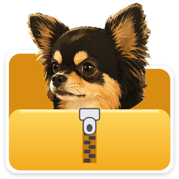

<h1 align="center">웅집 woong zip</h1>

광고 없는 무료 압축 프로그램 (Windows 10 · 11, 64비트) 
파일을 <b>오른쪽 클릭</b>해서 바로 압축하고 풀기 — zip · 7z · rar · tar · gz 등

## ⬇️ 내려받기

### **[웅집 1.0.2 내려받기 (zip, 22MB)](https://github.com/joese0211/woong-zip/raw/main/download/woong-zip-windows.zip)**

SHA256: `98E6F96E35231238579F8E9543A124860CB7E8E11608BD52773D790C7C650A73`

## 설치하기

1. 받은 `woong-zip-windows.zip` 을 마우스 오른쪽 단추로 누르고 **[모두 압축 풀기]** 를 고릅니다.
2. 풀린 폴더 안의 **WoongZip.exe** 를 두 번 누릅니다.
3. 파란 창 **"Windows의 PC 보호"** 가 뜨면 **[추가 정보]** → **[실행]** 을 누릅니다.
   (인증서를 사지 않은 작은 무료 프로그램이라 처음 한 번 보이는 안내예요. 설치한 뒤에는 다시 안 떠요.)
4. **"웅집 설치"** 창에서 **[설치하기]** 를 누릅니다. 바탕화면에 강아지 아이콘 **웅집** 이 생겨요.
5. 이어서 윈도우 **설정** 창이 열리면 맨 위의 **[기본값 설정]** 을 누르면 끝!
   이제 압축 파일을 두 번 누르면 웅집으로 열려요.
   - 윈도우는 "두 번 누르면 열 프로그램"을 사용자가 직접 골라야 해서 한 번 필요해요.
   - 설정 창에 웅집이 안 보이면, 윈도우를 한 번 **로그아웃 → 다시 로그인** 한 뒤 웅집 창 오른쪽 위
     **[더 보기] → [압축 파일을 웅집으로 열기 설정…]** 을 누르세요. (윈도우가 새 프로그램 목록을 로그인할 때 읽어서, 설치한 날 한 번만 그래요.)

설치는 내 계정에만 되고(`%LOCALAPPDATA%\Programs\WoongZip`), 관리자 권한은 필요 없어요.
설치가 끝나면 받은 압축 파일과 풀린 폴더는 지워도 돼요.

## 쓰는 법

> 윈도우 11 은 오른쪽 클릭 → 맨 아래 **[더 많은 옵션 표시]** 안에 웅집 메뉴가 있어요.
> **Shift** 를 누른 채 오른쪽 클릭하면 바로 보여요.

| 하고 싶은 것 | 방법 |
|---|---|
| 압축하기 (설정 고르기) | 파일 · 폴더 오른쪽 클릭 → **[웅집으로 압축하기…]** |
| 바로 zip 만들기 | 파일 · 폴더 오른쪽 클릭 → **[ZIP으로 바로 압축하기]** |
| 여러 개를 하나로 | 여러 개를 함께 고른 뒤 오른쪽 클릭 → 위 둘 중 하나 |
| 같은 폴더에 풀기 | 압축 파일 오른쪽 클릭 → **[여기에 풀기]** |
| 압축 파일 이름 폴더에 풀기 | 압축 파일 오른쪽 클릭 → **[새 폴더에 풀기]** |
| 원하는 곳에 풀기 | 압축 파일 오른쪽 클릭 → **[다른 곳에 풀기…]** |
| 안에 든 파일 보기 | 압축 파일 두 번 누르기 (또는 **[웅집으로 열기]**) |
| 필요한 것만 꺼내기 | 웅집 창에서 골라 탐색기 · 바탕화면으로 끌어다 놓기 |
| 압축 파일에 넣기 · 지우기 | 웅집 창의 **[넣기]** · **[지우기]** (zip · 7z · tar) |

- **암호**: 압축할 때 **[암호 걸기]** 를 고르면 돼요. 암호 걸린 압축 파일을 풀면 암호를 물어봐요.
  ZIP 암호에는 영어 · 숫자 · 기호만 쓸 수 있어요(한글 암호는 7Z 형식으로).
- **여러 개로 나눠 압축**: 메일에 붙이기 좋은 10MB 등으로 나눌 수 있어요. 받는 사람은 조각을 한 폴더에 모아 `.001` 을 풀면 돼요.
- **한글 이름**: 옛날 윈도우 압축 프로그램에서 만든 압축 파일이나 맥에서 만든 압축 파일도 한글 이름이 깨지지 않아요.
- 큰 파일은 진행 막대가 나오고 **[멈추기]** 로 그만둘 수 있어요.

**열 수 있는 형식**: zip · 7z · rar(rar5 포함) · tar · gz · tgz · bz2 · xz · zst · iso · cab · arj · lzh · wim · 나눠진 .001 등
(오른쪽 클릭 '풀기' 메뉴는 zip · 7z · rar · tar · gz · tgz · bz2 · xz · lzh · cab · zipx · .001 에 붙어요. 나머지는 웅집 창에 끌어다 놓으면 열려요.)
**아직 못 여는 것**: `.alz` · `.egg`(다른 압축 프로그램 전용 형식)

## 안전 검수

- **인터넷을 쓰지 않아요.** 인터넷 연결이나 포트를 여는 부품이 없어서 **Windows 방화벽 경고가 뜨지 않아요.**
  (실제로 돌리면서 연결 · 포트를 지켜봤을 때 0건)
- **Windows 디펜더 검사: 위협 없음** (2026-10-26, 서명 버전 1.461.204.0 — 받는 zip · 설치 폴더 모두)
- 인증서(유료 서명)가 없어서 처음 켤 때만 **"Windows의 PC 보호"** 창이 떠요 → **[추가 정보] → [실행]**.
  설치한 파일에서는 '인터넷에서 받은 파일' 표시를 지워서, 오른쪽 클릭 메뉴로 쓸 때는 다시 묻지 않아요.
- **스마트 앱 컨트롤**(윈도우 11 의 [Windows 보안] → [앱 및 브라우저 컨트롤])이 **켜진** PC 에서는 인증서 없는 프로그램이 아예 막혀서 쓸 수 없어요.

## 지우기

- Windows **[설정] → [앱] → [설치된 앱]** → 웅집 옆 **[⋯] → [제거]**
- 또는 웅집 창 오른쪽 위 **[더 보기] → [프로그램 정보] → [프로그램 지우기…]**
- 오른쪽 클릭 메뉴 · 연결도 함께 깨끗이 지워져요. 압축 파일들은 지워지지 않아요.

## 라이선스

웅집은 무료로 쓸 수 있어요.
압축 엔진은 **7-Zip 26.05** (Igor Pavlov, **GNU LGPL-2.1** + BSD + unRAR 제한)를 고치지 않고 그대로 담아 씁니다 — 원본 · 소스: [7-zip.org](https://www.7-zip.org/)
화면은 Qt 6 / PySide6 (**LGPL-3.0**) 를 고치지 않고 따로 떨어진 라이브러리 파일로 씁니다.
라이선스 원문(7-Zip · LGPL-3.0 · GPL-3.0 · Python PSF)과 소스 코드 받는 곳은 압축 안 `LICENSES` 폴더에 있어요.
